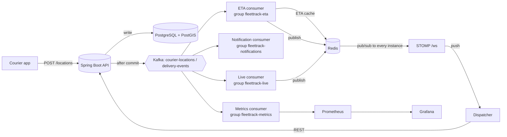
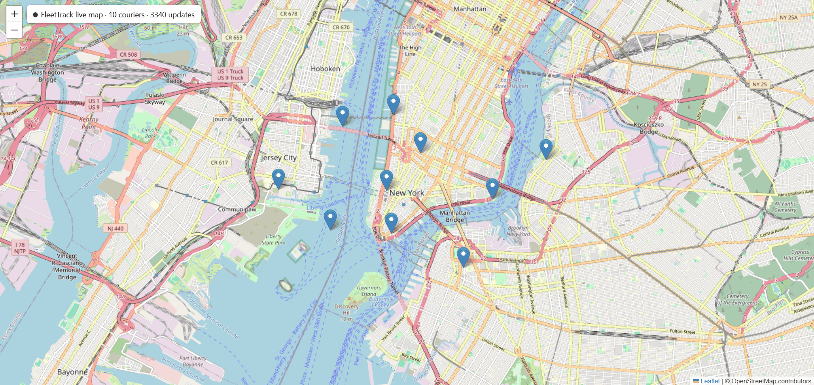
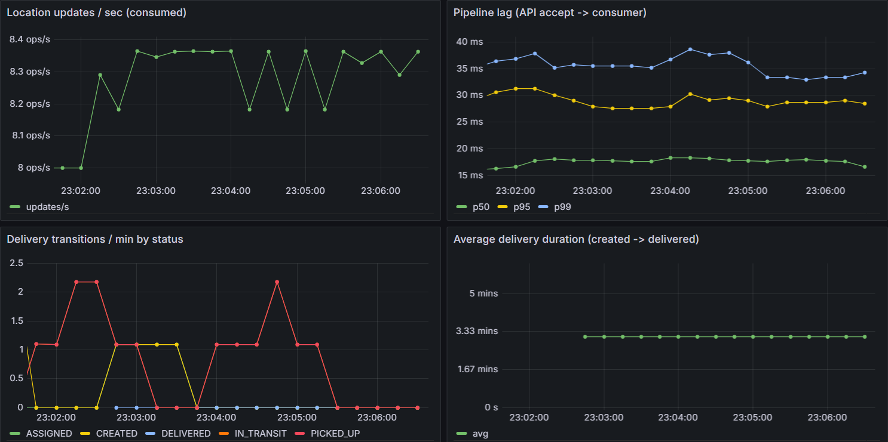
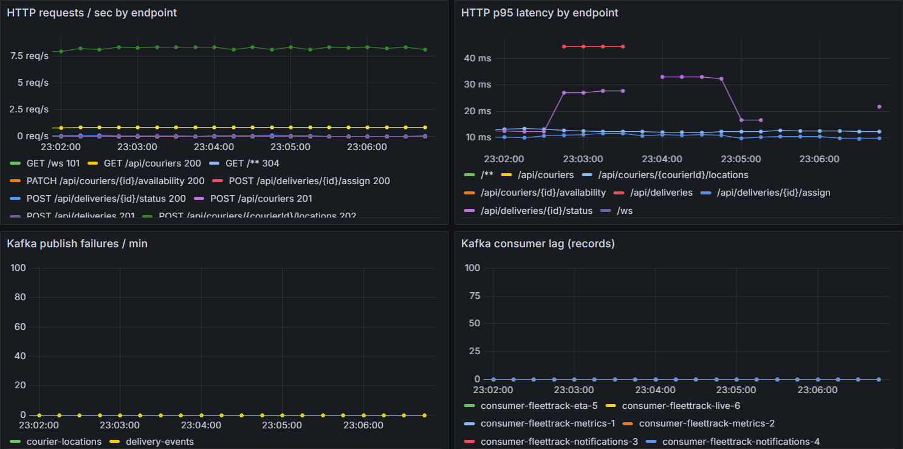

# FleetTrack — Real-Time Delivery Tracking Platform

Java 21 · Spring Boot 4.1 · PostgreSQL 16 + PostGIS · Kafka · WebSockets (STOMP) · Redis · Flyway · Micrometer/Prometheus/Grafana · Testcontainers · Docker · Kubernetes · GitHub Actions

Couriers stream GPS pings. FleetTrack stores them, finds the nearest available courier for a new delivery with PostGIS, drives each delivery through a strict state machine, and fans every position out over Kafka to independent consumers (ETA, notifications, metrics, live map). Dispatchers see couriers move in real time over WebSockets.



## See it running

**Live dispatcher map:** couriers move in real time over WebSockets (Kafka → Redis pub/sub → STOMP).



**Grafana: ingestion throughput, pipeline lag, delivery lifecycle**



**Grafana: HTTP traffic, latency, Kafka health**



### Measured locally

10 simulated couriers on one laptop (Windows 11, Docker Desktop with a 3 GB WSL2 limit), 5-minute window:

| Metric | Result |
|---|---|
| Location updates consumed | ~8.3 / s, steady |
| Pipeline lag, API accept → Kafka consumer | p50 ~18 ms · p95 ~29 ms · p99 ~35 ms |
| HTTP p95 latency, all endpoints | under 45 ms |
| Kafka publish failures | 0 |
| Kafka consumer lag | ~0 records, all groups |
| DB connection pool | at most 1 active, 0 waiting |
| Average delivery duration (created → delivered, simulated) | ~3.2 min |

These are local numbers that show the pipeline works end to end. They are not a load test; see the Roadmap.

---

## Quick start

Prerequisites: Java 21, Docker Desktop, Maven (IntelliJ's bundled Maven works).

```bash
# 1. Infrastructure: PostGIS, Kafka (KRaft), Redis, Prometheus, Grafana
docker compose up -d

# 2. App (or run FleettrackApplication from IntelliJ)
mvn spring-boot:run

# 3. Simulated couriers and deliveries
python scripts/simulate.py
```

| What | URL |
|---|---|
| Live dispatcher map | http://localhost:8080 |
| Health (liveness / readiness) | http://localhost:8080/actuator/health, `/actuator/health/liveness`, `/actuator/health/readiness` |
| Prometheus metrics | http://localhost:8080/actuator/prometheus |
| Prometheus UI | http://localhost:9090 |
| Grafana (admin/admin) | http://localhost:3000 → FleetTrack → FleetTrack Overview |

> **Coming from the earlier version of this project?** Your Docker volume holds an older `V1` migration, so Flyway will fail with *"Migration checksum mismatch"*. Reset the dev database once: `docker compose down -v && docker compose up -d`.

Everything in containers, including the app: `docker compose --profile app up -d --build`.

---

## API

```bash
# Couriers
curl -X POST localhost:8080/api/couriers -H 'Content-Type: application/json' \
  -d '{"name":"Bob","phone":"+15550200","vehicleType":"BICYCLE"}'
curl -X PATCH localhost:8080/api/couriers/1/availability -H 'Content-Type: application/json' -d '{"status":"AVAILABLE"}'
curl -X POST localhost:8080/api/couriers/1/locations -H 'Content-Type: application/json' \
  -d '{"latitude":40.7130,"longitude":-74.0055,"speedKmh":18}'              # 202 Accepted
curl 'localhost:8080/api/couriers/nearby?lat=40.7128&lng=-74.0060&radiusMeters=3000'
curl 'localhost:8080/api/couriers/1/locations?limit=20'                     # trail, newest first

# Deliveries
curl -X POST localhost:8080/api/deliveries -H 'Content-Type: application/json' -d '{
  "recipientName":"Ada","recipientPhone":"+15550100",
  "pickupLatitude":40.7128,"pickupLongitude":-74.0060,
  "dropoffLatitude":40.7306,"dropoffLongitude":-73.9866}'
curl -X POST localhost:8080/api/deliveries/1/assign                         # nearest available courier
curl -X POST localhost:8080/api/deliveries/1/assign -H 'Content-Type: application/json' -d '{"courierId":1}'
curl -X POST localhost:8080/api/deliveries/1/status -H 'Content-Type: application/json' -d '{"status":"PICKED_UP"}'
curl localhost:8080/api/deliveries/1/eta
curl localhost:8080/api/deliveries/1/history
```

| Method & path | Purpose | Notable responses |
|---|---|---|
| `POST /api/couriers` | register courier | 201, 400 validation, 409 duplicate phone |
| `GET /api/couriers[?status=]`, `GET /api/couriers/{id}` | read | 404 |
| `PATCH /api/couriers/{id}/availability` | AVAILABLE / OFFLINE | 409 if BUSY |
| `GET /api/couriers/nearby?lat&lng&radiusMeters&limit` | PostGIS proximity search | 400 bad coordinates |
| `POST /api/couriers/{id}/locations` | ingest ping | 202, 404 |
| `GET /api/couriers/{id}/locations?limit` | location history | |
| `POST /api/deliveries` | create | 201 |
| `POST /api/deliveries/{id}/assign` | assign given or nearest courier | 409 none in range / courier busy / wrong state |
| `POST /api/deliveries/{id}/status` | PICKED_UP, IN_TRANSIT, DELIVERED, CANCELLED | 409 illegal transition or concurrent update |
| `GET /api/deliveries/{id}/history` | audit trail | |
| `GET /api/deliveries/{id}/eta` | latest ETA (Redis) | 404 not computed yet |

Errors are RFC 9457 `application/problem+json` (`title`, `status`, `detail`, plus `errors` for field validation).

WebSocket: connect STOMP to `ws://localhost:8080/ws`, subscribe to `/topic/couriers`, `/topic/couriers/{id}` or `/topic/deliveries/{id}/eta`.

---

## Where each resume bullet lives in the code

| Claim | Code |
|---|---|
| Event-driven: location updates → Kafka → independent ETA / notification / metrics consumers; a failing consumer doesn't block ingestion | `location/LocationService`, `messaging/KafkaEventPublisher` (after-commit, async send), `tracking/eta/EtaConsumer`, `tracking/notification/NotificationConsumer`, `tracking/metrics/MetricsConsumer` (each its own consumer group), `messaging/KafkaErrorHandlingConfig` (retry → dead-letter topic) |
| Normalized PostGIS schema, geography types, GiST indexes, nearest-courier-within-radius | `db/migration/V1..V3`, `courier/CourierRepository#findAvailableNearby`, `#lockNearestAvailable` |
| Delivery state machine rejecting illegal transitions in the service layer | `delivery/DeliveryStatus`, `delivery/Delivery#transitionTo`, `delivery/DeliveryService` |
| Flyway versioned migrations + Hibernate `validate` | `db/migration`, `application.yaml` (`ddl-auto: validate`), `it/FleettrackApplicationIT` |
| Layered REST API, Bean Validation DTOs, constructor injection, `@RestControllerAdvice` → 404/409/400 | `*Controller`, `*Service`, `*Repository`, `*/dto/*Request`, `common/exception/GlobalExceptionHandler` |
| Live positions over WebSockets with Redis pub/sub fan-out | `realtime/*`, `tracking/live/LivePositionConsumer`, `static/index.html` |
| Testcontainers integration tests against real PostgreSQL | `support/AbstractIntegrationTest`, `it/*IT` |
| Micrometer + Prometheus + Grafana; Actuator probes wired to Kubernetes | `MetricsConsumer`, `monitoring/`, `application.yaml` (`management.*`), `k8s/deployment.yaml` |
| Docker + Kubernetes + GitHub Actions (build, test, push on merge) | `Dockerfile`, `docker-compose.yml`, `k8s/`, `.github/workflows/ci.yml` |

---

## Tests

```bash
mvn test      # unit + web-slice tests (no Docker needed)
mvn verify    # + Testcontainers integration tests (needs Docker running)
```

* **Unit:** state machine (every legal and illegal transition), entity rules, `DeliveryService` with Mockito, ETA maths.
* **Web slice (`@WebMvcTest`):** validation errors, status-code mapping (400/404/409), malformed JSON.
* **Integration (`*IT`, failsafe):** real `postgis/postgis:16-3.4` and `redis:7-alpine` containers plus an embedded Kafka broker. They cover the full delivery lifecycle, nearest-courier assignment, out-of-order pings, the double-booking guard in the database, and ping → Kafka → ETA + metrics consumers.

---

## Kubernetes

```bash
kubectl apply -f k8s/namespace.yaml
kubectl apply -f k8s/dev-infra/infra.yaml            # DEV ONLY: Postgres/Kafka/Redis in-cluster
kubectl -n fleettrack create secret generic fleettrack-db \
  --from-literal=DB_USERNAME=fleettrack --from-literal=DB_PASSWORD=fleettrack
kubectl apply -f k8s/configmap.yaml -f k8s/deployment.yaml -f k8s/service.yaml -f k8s/hpa.yaml
```
Set the image in `k8s/deployment.yaml` to your GHCR image (`ghcr.io/<your-github-user>/fleettrack`). For a public pull, make the package public in GitHub. Otherwise add an `imagePullSecret`.

**CI/CD** (`.github/workflows/ci.yml`): every push and PR runs `mvn verify` (including the Testcontainers ITs). Pushes to `main`/`master` also build the Docker image and push it to GHCR, tagged with the git SHA and `latest`. An optional deploy job (`kubectl set image` + `rollout status`) runs when the repo variable `DEPLOY_ENABLED=true` and the secret `KUBE_CONFIG` are set.

---

## Design decisions

Each decision below is written as problem → decision → trade-off.

**Why Kafka between ingestion and processing?** Pings arrive every few seconds per courier. If ETA, notifications and metrics ran inline, the slowest of them would set ingestion latency, and a failure in any of them would fail the ping. Instead the API does only the essential write (history row plus latest position) and publishes an event. Each concern is its own **consumer group**, so each gets every event, keeps its own offset, scales on its own, and can fail without affecting the others. *Trade-off:* eventual consistency (the ETA lags the ping by milliseconds to seconds) and one more piece of infrastructure to run.

**Ordering.** Events are keyed by `courierId`, so one courier's pings land on one partition in order. There is no global order, and none is needed. Partition count (6) caps consumer parallelism per group.

**Publish after commit.** `@TransactionalEventListener(AFTER_COMMIT)` means consumers never see data that was rolled back. *Trade-off:* a crash between commit and send loses that event. That's fine for pings, since the next one arrives seconds later. For delivery events the production fix is a **transactional outbox** (write the event to a table in the same transaction and relay it to Kafka).

**At-least-once consumers.** Kafka can redeliver. The "arriving soon" notification uses Redis `SET NX` so it is sent once, and ETA writes are idempotent overwrites. A failing record is retried 3× and then sent to `<topic>.DLT` rather than blocking its partition.

**Why Redis pub/sub on top of Kafka for WebSockets?** A consumer group gives each record to exactly one instance, but a dispatcher's WebSocket may be connected to any instance. Redis pub/sub broadcasts to every instance, and each pushes to its own clients.

**Geography columns generated by the database.** `last_location geography(Point,4326) GENERATED ALWAYS AS (ST_MakePoint(lng, lat)) STORED`. The entity maps plain `lat/lng` (no hibernate-spatial), PostGIS keeps the geography column in sync, and it can never drift. `geography` rather than `geometry` because it gives real metres on a sphere.

**Why proximity stays fast as history grows.** "Nearest available courier" queries `couriers.last_location` (one row per courier, GiST-indexed via `ST_DWithin`), never the append-only `courier_locations` table. History grows without limit, but the hot query's data set doesn't.

**Concurrency on assignment, three layers:**
1. `SELECT … FOR UPDATE SKIP LOCKED` on the courier. Two simultaneous auto-assignments get *different* couriers instead of blocking or double-booking (verified with two concurrent sessions).
2. `@Version` optimistic locking on `Delivery` and `Courier`: a concurrent change to the same row gets **409** rather than a lost update.
3. A partial unique index, `UNIQUE (courier_id) WHERE status IN ('ASSIGNED','PICKED_UP','IN_TRANSIT')`: even buggy code can't give a courier two active deliveries.

> Gotcha found while building: PostgreSQL raises *"attempted to lock invisible tuple"* when a KNN-ordered (`<->`) GiST scan is combined with `FOR UPDATE`. So the locking query orders by `ST_Distance` (`ST_DWithin` still uses the index to narrow candidates), and only the read-only search uses KNN.

**High-frequency writes vs optimistic locking.** Position updates use a JPQL bulk `UPDATE` that does *not* bump `@Version`. Otherwise every ping would invalidate concurrent dispatcher edits. The same statement drops out-of-order pings atomically (`WHERE last_seen_at < :recordedAt`).

**State machine in the domain, not the controller.** `DeliveryStatus` holds the transition table, and `Delivery#transitionTo` is the only way to change status (there is no setter). An illegal transition is a **409**, not a 400, because the same request would be valid if the delivery were in another state.

**Flyway + `ddl-auto: validate`.** The schema changes only through reviewed, versioned SQL. Hibernate checks entities against it at startup, so drift fails the deploy rather than a request at 3 a.m.

**ETA in Redis, not Postgres.** ETAs change on every ping and expire within minutes. Storing them in Postgres would mean a write per ping per delivery and lock contention with dispatcher updates. Redis with a TTL fits that data.

**Liveness vs readiness.** Liveness checks only the JVM. If it included the DB, a database blip would make Kubernetes restart every pod at once. Readiness includes the DB and Redis, so a pod that can't reach them is taken out of rotation, not killed.

**Metric cardinality.** Tags are bounded (`status`, `topic`), never `courierId`. Every distinct tag value is a separate Prometheus time series.

## Roadmap
* Transactional outbox for delivery events (Debezium or a polling relay).
* Split the consumers into separately deployed services. They are already isolated by consumer group and package, so the split is a packaging change.
* Partition or TTL `courier_locations` by time (native partitioning or TimescaleDB) as history grows.
* Road-network ETA (OSRM/Valhalla) behind the existing `EtaCalculator` seam.
* AuthN/Z (Spring Security + JWT; couriers can only post their own location).
* Rate-limit location ingestion per courier.
* Load test location ingestion (Gatling or k6) to find the throughput ceiling per instance and the point where pipeline lag starts to grow.
